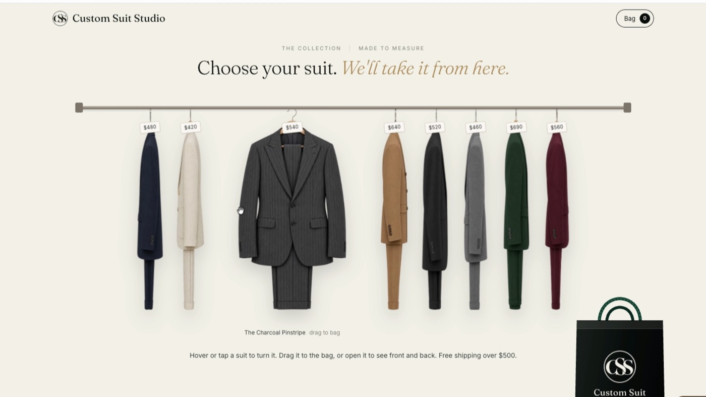
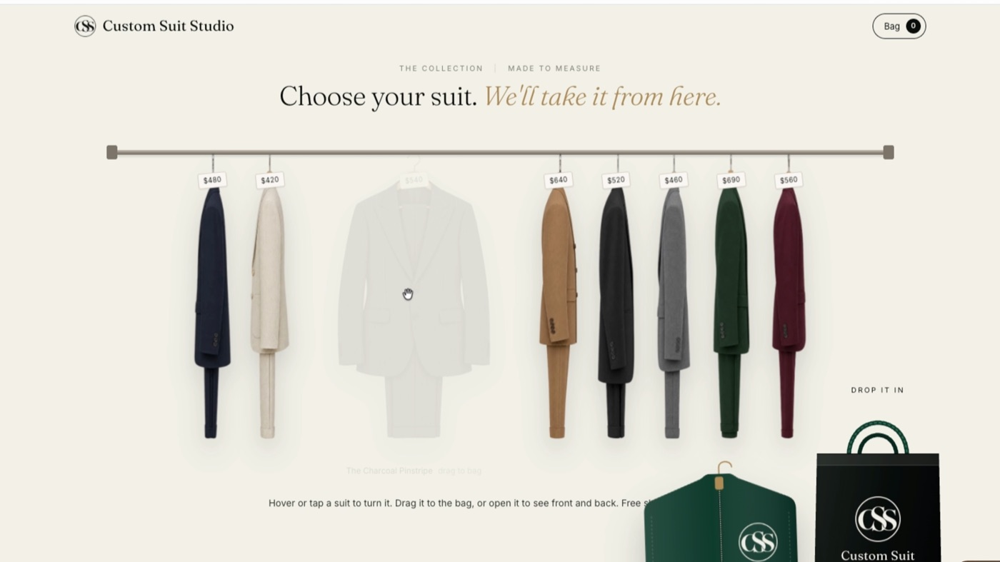
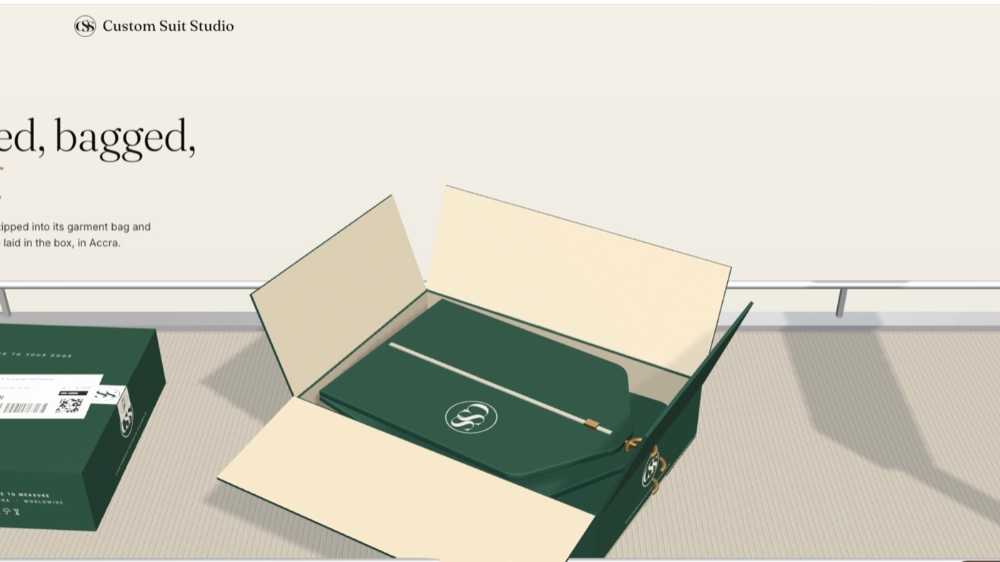
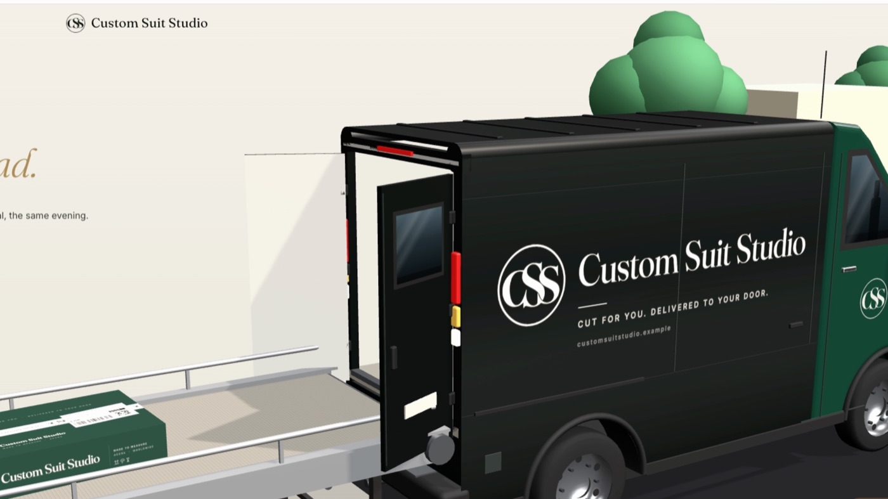
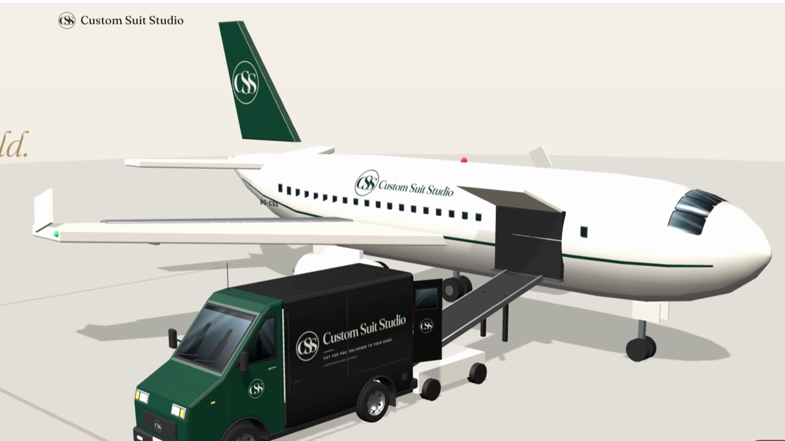
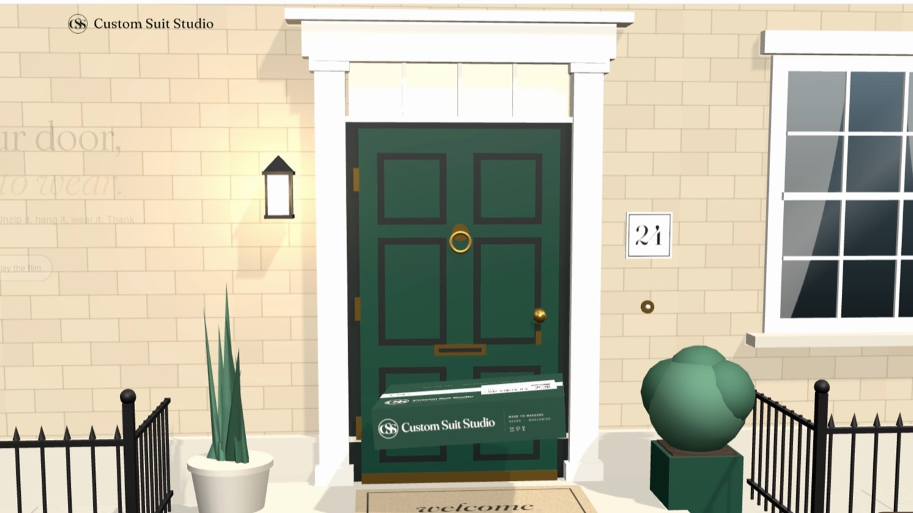

# Custom Suit Studio

A demo storefront for a made-to-measure suit brand, built by Claude Fable 5.2 with the [rail-to-door](https://github.com/KooEmmanuel/rail-to-door) Claude Code skill.

Pick a suit from the rail, drag it into the bag, check out, then scroll through the order's trip: packed and labelled, down the conveyor, into the van, onto the plane, across the map from Accra, and onto the customer's doorstep.








## Run it

```bash
git clone https://github.com/KooEmmanuel/custom-suit-studio.git
cd custom-suit-studio
python3 serve.py
```

Then open http://localhost:8791.

There's nothing to install: it's plain HTML, CSS and JavaScript with three.js. (It has to be served, not opened as a file, because it uses ES modules.)

## What's in it

| File | What it does |
|---|---|
| `index.html` | The page and its copy |
| `brand.json` | Name, colours, origin city, vehicle colours |
| `css/style.css` | All styles |
| `js/shop.js` | The rail, hover-turn, viewer, drag to the bag, drawer, checkout |
| `js/journey.js` | The scroll-driven 3D film |
| `js/models.js`, `js/parcels.js`, `js/world.js` | The van, plane, conveyor, box, map and house |
| `assets/rail/` | Suit images (front, back, side), generated with Higgsfield |

The payment screen is a demo; no card details are taken.

## Licence

Apache 2.0. The bundled three.js (r160) is MIT-licensed, © three.js authors. The world map uses Natural Earth data (public domain). The brand is fictional.
